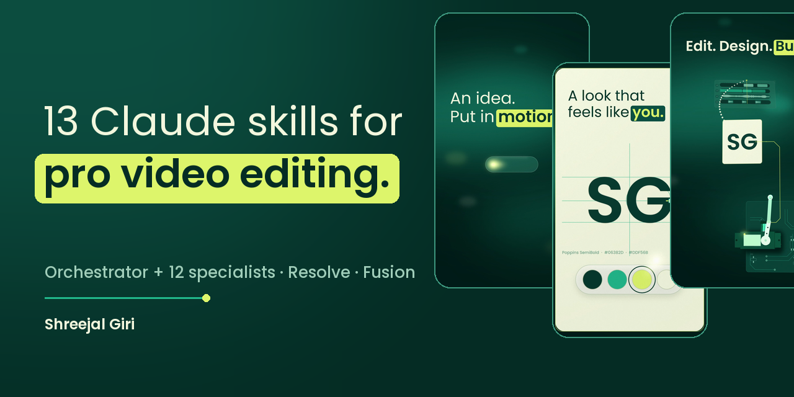

<p align="center"></p>

# Claude Video Mastery Skills

13 [Claude Code](https://claude.com/claude-code) skills for professional video editing, built around DaVinci Resolve and Fusion, with a focus on Nepali documentary, NGO and social-reel work.

One orchestrator skill runs the whole edit and calls in 12 specialist skills only when a stage needs them.

## The skills

| Skill | What it does |
|---|---|
| `master-video-editor-workflow` | Orchestrator. Runs the edit from brief to final export and routes each stage to the right specialist. |
| `visual-storytelling-god` | Turns narration into honest, compelling visuals and visual metaphors. |
| `documentary-research-factchecking-master` | Checks claims, numbers and visual truth before they go on screen. |
| `cinematic-editing-pacing-master` | Cuts, rhythm, continuity and documentary pacing. |
| `cinematography-shot-composition-master` | Shot language, framing, light and spatial continuity. |
| `broll-visual-asset-research-master` | Finds relevant B-roll and tracks rights and provenance. |
| `motion-design-transitions-master` | Restrained, meaning-driven motion graphics and transitions. |
| `fusion-parallax-vfx-master` | 2.5D compositing, camera moves and Fusion node graphs. |
| `nepali-type-fusion-master` | Nepali Devanagari typography and kinetic text in Resolve/Fusion, with Unicode rendering checks. |
| `sfx-mastermind` | Sound design, foley, ambience, cue sheets and licensed SFX scouting. |
| `music-scoring-emotional-rhythm-master` | Picks and edits music as story structure. |
| `color-grading-film-look-master` | Consistent, story-motivated color in DaVinci Resolve. |
| `davinci-automation-final-qc-master` | Claude-to-Resolve automation and technical QC of the final master. |

## Install

Copy the skills you want into your Claude Code skills folder:

```bash
git clone https://github.com/shreejalgiri6/claude-video-mastery-skills.git
cp -R claude-video-mastery-skills/skills/* ~/.claude/skills/
```

Restart Claude Code, then ask for an edit, for example "edit this documentary reel using the master video editor workflow".

## Notes

- Resolve automation assumes a DaVinci Resolve MCP server or scripting bridge is connected. Without one, the skills produce a production-ready plan and handoff instead.
- `master-video-editor-workflow` mentions a house skill called `resolve-lua-bridge` and reference files that are not part of this repo. It falls back to its own instructions when they're missing.

## Author

Made by [Shreejal Giri](https://shreejalgiri.com.np) with Claude.

## License

MIT. See [LICENSE](LICENSE). Contributions are welcome: see [CONTRIBUTING.md](CONTRIBUTING.md).
